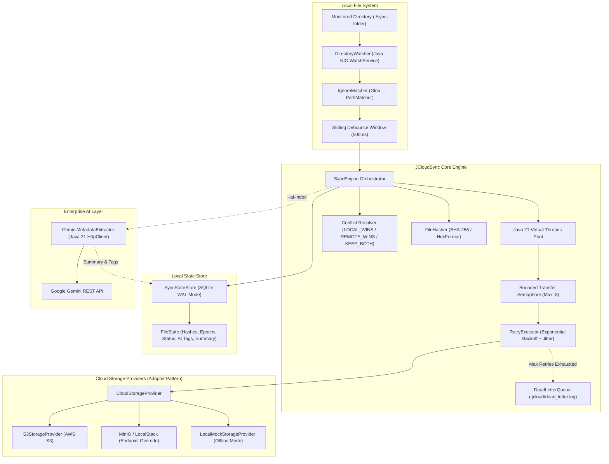
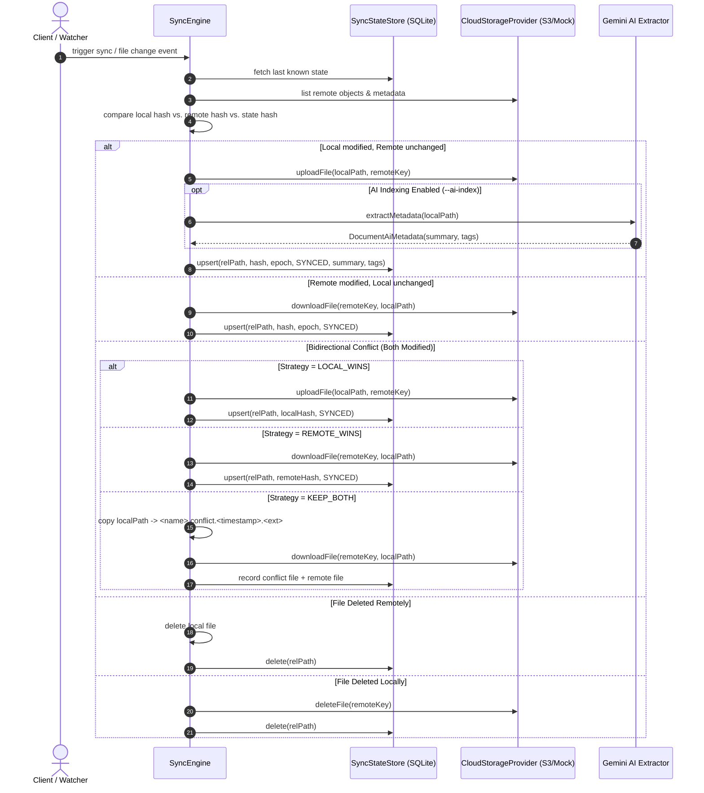

# JCloudSync

> **Enterprise-grade, bidirectional cloud synchronization tool written in modern Java 21.**  
> Built with Java NIO, SQLite, AWS SDK v2, Picocli, Java 21 Virtual Threads, and Google Gemini AI Semantic Indexing.

[](https://openjdk.org/projects/jdk/21/)
[](https://maven.apache.org/)
[](https://aws.amazon.com/s3/)
[](LICENSE)

---

## Architecture Overview



---

## Bidirectional Sync & Conflict Resolution



---

## Core Features

- **Java 21 Virtual Threads**: Massive throughput using `Executors.newVirtualThreadPerTaskExecutor()` paired with a bounded `Semaphore` to prevent socket starvation and cloud throttling.
- **SQLite Metadata Engine**: Embedded SQLite database (`state.db`) configured with Write-Ahead Logging (`PRAGMA journal_mode=WAL`) for atomic upserts and sub-millisecond status lookups.
- **FDE Multi-Cloud Adapter Pattern**: Uniform `CloudStorageProvider` interface supporting AWS S3, MinIO, LocalStack, and offline `LocalMockStorageProvider`.
- **Intelligent Change Detection**: Computes cryptographic SHA-256 hashes via `MessageDigest` and `HexFormat` to differentiate actual byte alterations from metadata-only filesystem touches.
- **Sliding Debounce Window**: Java NIO `WatchService` with recursive directory registration that coalesces rapid editor saves and discards ephemeral temp files.
- **Exponential Backoff with Full Jitter**: Resilient network retries with randomized backoff delays and a dead-letter log (`.jcloud/dead_letter.log`).
- **AI Semantic Search**: Integrates Google Gemini 1.5 Flash via Java 21 `HttpClient` to extract document summaries and semantic topic tags for full-text keyword and semantic search.

---

## CLI Usage Guide

Build the executable fat JAR:
```bash
mvn clean package
```

### 1. Initialize Starter Configuration
```bash
java -jar target/jcloud-sync-1.0.0-SNAPSHOT.jar init
```
Generates a starter `config.yaml` with bucket details, watch directory, and default ignore patterns.

### 2. Run a Single Reconciliation Pass
```bash
# Sync once with remote AWS S3 / MinIO
java -jar target/jcloud-sync-1.0.0-SNAPSHOT.jar sync --once

# Sync once in offline mock mode
java -jar target/jcloud-sync-1.0.0-SNAPSHOT.jar sync --once --mock

# Sync once with AI Semantic Indexing enabled
export GEMINI_API_KEY="your-api-key"
java -jar target/jcloud-sync-1.0.0-SNAPSHOT.jar sync --once --ai-index
```

**Sample Reconciliation Output:**
```text
================================================================================
                     JCLOUDSYNC RECONCILIATION SUMMARY                          
================================================================================
  Target: s3://jcloud-sync-dev | Strategy: KEEP_BOTH | AI Indexing: ENABLED
--------------------------------------------------------------------------------
  CATEGORY               COUNT    DETAILS / FILES                              
--------------------------------------------------------------------------------
  Uploaded (Local)       3        docs/architecture.md, data/q3-report.pdf (+1 more)
  Downloaded (Remote)    1        specs/api-contract.yaml                      
  Skipped (In Sync)      12       (Files up to date)                           
  Conflicted (Resolved)  1        notes.txt (.conflict created)                
  Deleted (Local)        0        -                                            
  Deleted (Remote)       0        -                                            
  Errors / DLQ           0        -                                            
--------------------------------------------------------------------------------
  Reconciliation Status: SUCCESS (Total Processed: 17)
================================================================================
```

### 3. Continuous File System Watcher Daemon
```bash
java -jar target/jcloud-sync-1.0.0-SNAPSHOT.jar watch --ai-index
```
Recursively watches the target directory for real-time changes. Supports graceful shutdown on `Ctrl+C` (SIGINT/SIGTERM) via runtime shutdown hooks.

### 4. Inspect State & Metrics
```bash
java -jar target/jcloud-sync-1.0.0-SNAPSHOT.jar status
```
Displays tracked files, synchronization status (`SYNCED`, `PENDING`, `CONFLICT`), file sizes, and hash prefixes.

### 5. Semantic Search
```bash
java -jar target/jcloud-sync-1.0.0-SNAPSHOT.jar search "virtual threads"
```

**Sample Search Output:**
```text
================================================================================
                         JCLOUDSYNC SEMANTIC SEARCH                             
================================================================================
  Query: "virtual threads" | Target: s3://jcloud-sync-dev/
--------------------------------------------------------------------------------
  [1] docs/architecture.md
      Cloud URI: s3://jcloud-sync-dev/docs/architecture.md
      Status:    SYNCED (4.2 KB)
      Tags:      [architecture, virtual-threads, concurrency, s3]
      Summary:   Technical specification outlining Java 21 Virtual Threads and semaphore-bounded cloud transfers.
--------------------------------------------------------------------------------
  Total Matches: 1
================================================================================
```

---

## Configuration (`config.yaml`)

```yaml
watchDirectory: "./sync-folder"
s3Bucket: "jcloud-sync-dev"
s3Region: "us-east-1"
s3EndpointOverride: "http://localhost:4566"   # Optional: MinIO / LocalStack URL
debounceMs: 500                              # Coalescing window in milliseconds
metricsPort: 9090
conflictStrategy: "KEEP_BOTH"                # LOCAL_WINS | REMOTE_WINS | KEEP_BOTH
aiIndexingEnabled: false                     # Set true or pass --ai-index flag
ignorePatterns:
  - "*.tmp"
  - "*.swp"
  - ".git/**"
  - ".DS_Store"
  - ".jcloud/**"
```

---

## Benchmark & Design Notes

### 1. Java 21 Virtual Threads vs. OS Thread Pools
Traditional thread pool executors (`ThreadPoolExecutor`) incur ~1 MB stack memory overhead per thread and context switching penalties when managing hundreds of concurrent transfer sockets. JCloudSync uses **Java 21 Virtual Threads** (`Thread.ofVirtual()`), allowing millions of concurrent tasks to block on network and disk I/O without monopolizing OS threads.

### 2. Bounded Concurrency via Semaphores
Spawning unbounded transfers across hundreds of files can trigger TCP socket exhaustion, local file descriptor limits (`ulimit`), or S3 HTTP 503 SlowDown rate limits. JCloudSync pairs virtual threads with a **`Semaphore(maxConcurrentTransfers)`** (default 8 permits) so only $N$ active network streams transfer simultaneously, while queued tasks remain parked on virtual thread continuations with negligible CPU overhead.

### 3. Zero-Allocation Cryptographic Fingerprinting
Using `java.util.HexFormat.of().formatHex(...)` combined with a 64 KB `InputStream` buffer eliminates unnecessary intermediate string and byte allocations during SHA-256 calculation.

### 4. SQLite Write-Ahead Logging (WAL)
By enabling `PRAGMA journal_mode=WAL` and `PRAGMA synchronous=NORMAL`, reads and writes to `state.db` execute concurrently without database lock contention.

---

## Docker & Local MinIO Deployment

`jcloud-sync` includes production Docker and Docker Compose definitions for running locally against a containerized MinIO S3 cluster.

### 1. Multi-Stage Docker Build
Build the minimal non-root production container (`eclipse-temurin:21-jre-alpine`):
```bash
docker build -t jcloud-sync:latest .
```

### 2. Run Local MinIO + JCloudSync Stack
Start MinIO, initialize the `jcloud-sync-dev` bucket, and run `jcloud-sync` continuous daemon:
```bash
docker compose up -d
```
- **MinIO S3 API:** `http://localhost:9000`
- **MinIO Web Console:** `http://localhost:9001` (User: `minioadmin`, Pass: `minioadmin`)
- **Synced Folder:** Bound to `./sync-folder` on your host.

---

## Automated CI/CD Pipeline

The `.github/workflows/ci.yml` workflow runs automatically on every push and pull request to `main`/`master`:
1. **Build & Test**: Compiles on Temurin JDK 21 and runs JUnit 5 + Testcontainers tests.
2. **Package**: Builds the executable fat JAR and executes smoke tests (`init`, `sync --once --mock`, `status --mock`).
3. **Artifact Archive**: Stores `target/jcloud-sync-1.0.0-SNAPSHOT.jar` for release distribution.
4. **Docker Verification**: Runs Docker Buildx to validate the multi-stage container build and executes a container smoke test.

